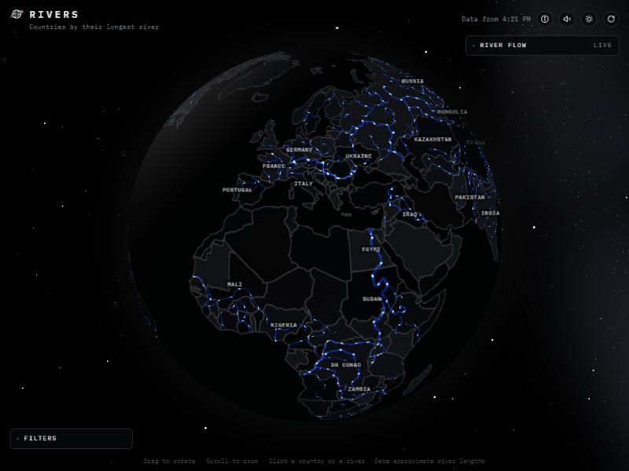
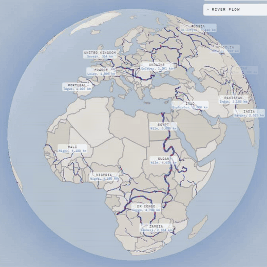
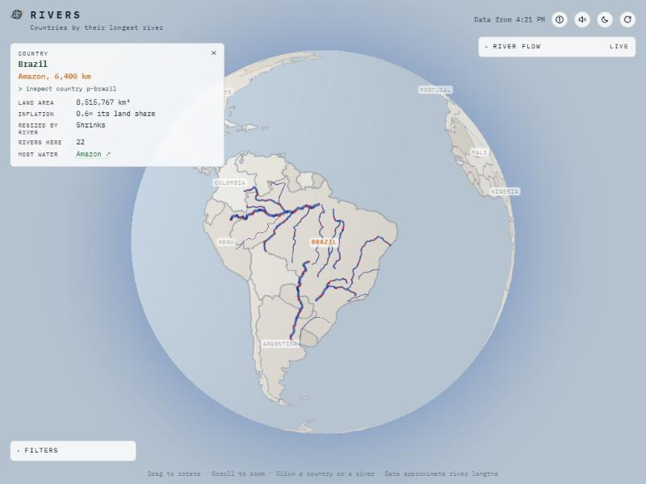

# Rivers



An interactive Earth of the world's longest rivers and the countries they cross, built from the aunai-org `earth-template`.

- Country names sit at each country's centre. Click one to see only the rivers that cross it, or click a river line to see it alone. The search box finds both.
- Land areas and river lengths are in `data/rivers.csv`. The figures are approximate, written from memory, and a shared river counts in full for each country.
- "Inflation" is a country's share of total river length divided by its share of total land area.

Two views sit at the top of the Filters panel:

- **Inflate by river**: the land morphs into an area cartogram, where each country's area follows its longest river. Labels and rivers move with it, and a card explains the view and its colour key.
- **River flow · live**: 335 Natural Earth rivers draw out from source to mouth, and pulses run downstream. Width and pace follow today's modelled discharge from the Open-Meteo Flood API (GloFAS). A legend card shows the width scale and the rivers in view by today's flow. This is the only time the page contacts another site.
- **Light or dark globe**: the sun/moon button switches between a night globe among the stars and a pale paper map with dark-blue rivers. The first visit follows the system setting.



*Inflate by river, light globe. Colour shows the length of each country's longest river.*



*Click a country to see only its rivers; the card gives its figures.*

## Run it

```bash
npm install
npm run dev     # first request for /inflate.json builds the cartogram (a few seconds)
npm test        # node --test: cartogram, river chaining and direction, assets, ribbon maths
npm run build
```

## Deploy to Cloudflare

The site is static: `npm run build` writes `dist/`, and Cloudflare Workers serves it as static assets (`wrangler.jsonc`).

```bash
npx wrangler login      # once
npm run deploy          # build, then wrangler deploy
```

River flow goes through a small Worker (`worker/index.ts`) at `/api/flood`. It accepts only the one request the site makes, answers from Cloudflare's edge cache when it has the same points (kept 6 hours, since GloFAS publishes once a day), and otherwise asks Open-Meteo once and stores the answer for every visitor. Errors are passed on and never cached. The browser only ever talks to the site itself, so `public/_headers` sets `connect-src 'self'`, with no outside host. There is no API key today; a paid one would be added to the Worker as a secret. Open-Meteo's free API is for non-commercial use and asks for attribution (CC BY 4.0), which the River flow card and the About panel carry.

The template's own notes are in `docs/`. Licensed MIT (see `LICENSE`).
